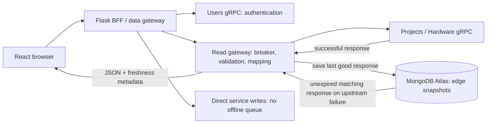

# Hardware rental project

React frontend with Flask adapters for the Users/MFA gRPC service,
the Projects gRPC service, and the Hardware gRPC API.

## Run locally

1. Create a root `.env`. Confirm `PROJECTS_GRPC_TARGET`,
   `USERS_GRPC_TARGET`, `HARDWARE_API_BASE_URL_grpc`, `HARDWARE_API_KEY`,
   and the Hardware team identity. Obtain missing provider settings from their owners.
2. Install dependencies: `npm install`, `npm install --prefix client`, and
   `python -m pip install -r requirements.txt`.
3. Run `npm run dev` from the repository root.

Vite reads the root `.env`. `VITE_API_BASE_URL` points to Flask (locally
`http://127.0.0.1:5050`). In production, leave it empty for same-origin requests.
Restart Vite/rebuild after changing Vite variables. Users/MFA, Projects and Hardware
always use real adapters: their browser mocks, demo accounts and review-scenario
controls have been removed. Old `VITE_USE_MOCKS`/`VITE_MOCK_DELAY_MS` settings are
ignored. Real sign-in and MFA are required; `demo/demo` and arbitrary six-digit
codes are no longer review credentials.

The Overview aggregate is still unconfirmed on this branch; there is no matching
Flask `/api/visualization` route. Its normal client reports unavailable when no
real source is configured. `VITE_USE_VISUALIZATION_MOCKS=true` explicitly enables
only a labelled **Sample Overview**. It never intercepts authentication, project
or hardware calls and does not supply verified agency/inventory figures.

| Browser API (Flask) | Upstream contract | Configuration |
| --- | --- | --- |
| `/api/users-service/*` | Users/MFA gRPC | `USERS_GRPC_TARGET` (default defined in `server/users/client.py`) |
| `/api/projects-service/*` | Projects gRPC | `PROJECTS_GRPC_TARGET` |
| POST `/api/hardware`, `/api/listAllocations` and existing hardware write routes | Hardware gRPC | `HARDWARE_API_BASE_URL_grpc`, `HARDWARE_API_KEY`, `HARDWARE_API_TEAM` |

The active contracts are `server/projects/projects.proto`,
`server/hardware/hardware.proto`, and `server/users/users.proto`.
The checked-in Projects proto is labelled draft v0.1; the team's v0.2 source and
November 17 Hardware revision must be supplied and compared before claiming those
contract updates are complete. The retired Projects v1.4 document is retained in
`docs/contracts/`; Hardware REST specs are in `docs/archive/` for historical reference.
Endpoint contracts do not prove credentials, reachability or end-to-end acceptance.

## Service boundaries

- `client/src/services/http.js`: shared browser HTTP/session transport.
- `client/src/services/projects.js`: Projects API operations.
- `client/src/services/hardware.js`: inventory, allocations, retry orchestration,
  and joined allocation/catalog data for project details and resource rental.
- `client/src/services/users.js`: Users-service registration/login/MFA/profile client.
- `server/app.py`: Flask entry point, users, authentication, and hardware routes.
- `server/routes/projects.py`: authenticated Projects API routes under
  `/api/projects-service`, separate from React's `/projects/...` navigation.
- `server/projects/client.py`: server-to-server Projects gRPC transport using
  `PROJECTS_GRPC_TARGET`; maps protobuf responses and upstream errors to HTTP/JSON.
- `server/services/hardware.py`: hardware application operations and response mapping.
- `server/hardware/client.py`: working gRPC transport and checkout lookup logic.
- `server/hardware/hardware.proto` and generated bindings: hardware wire contract.
- `server/users/client.py`: Users gRPC transport and access-token validation.
- `server/gateway/`: response validation, field mapping, snapshot fallback, and circuit breakers.
- `server/edge/mongo.py`: active MongoDB client for snapshots only.
- `server/edge/store.py`: MongoDB/temporary memory snapshot store implementations.
- `server/legacy/`: retired local account/project persistence and old Projects REST adapter;
  no active application module imports it.

Authentication uses Users gRPC; projects and inventory use their owning gRPC services.
The removed `/api/signup`, `/api/forgot_password`, and `/api/users` routes are unavailable.
The recovery page directs users to their agency administrator because the current Users
contract has no recovery endpoint. No local password-reset implementation is exposed.

## Edge snapshots and outage behavior



The edge node is currently a software layer inside Flask, not a separately deployed
local device. Every covered read tries the live service first. Successful, validated
responses below the payload limit are saved. A service availability failure, open
circuit, or whole-response validation failure can return a matching, unexpired
snapshot with `meta.source = "cache"` and `meta.stale = true`. The browser displays a
saved-data banner. Snapshots are refreshed by successful requests, not by a background
sync job. Cache keys include service, endpoint, org scope, and request parameters.

| Covered read | Default maximum snapshot age |
| --- | --- |
| Hardware catalog | 24 hours |
| Allocations | 1 hour |
| Project details and searches | 6 hours |

These are a temporary read fallback, not complete database backups. A request must
have succeeded previously with matching parameters. New searches/pages can have no
snapshot. Expired snapshots are rejected even before MongoDB's TTL cleanup removes them.
Authentication, MFA, user profiles, pricing/budget reads and Overview are not snapshotted.
Checkout, return, reservation and project/membership writes always use live services.

| Failure | Result |
| --- | --- |
| Hardware or Projects unavailable; Flask, Atlas and Users reachable | Covered reads can use existing unexpired snapshots; failed mutations are not queued |
| Users unavailable | Protected reads fail before checking snapshots, even with a previously issued token |
| Flask loses internet to all cloud dependencies | Atlas and Users cannot be reached, so cloud snapshots cannot provide offline continuity |
| Browser cannot reach Flask, or Flask is down | No new API responses; there is no browser offline cache |
| Atlas unavailable while live services work | Live reads continue, but snapshot reads/writes fail |
| Flask restarts | Atlas snapshots survive; in-memory snapshots, breakers and metrics do not |

`EDGE_STORE=auto` selects MongoDB at initialization or an empty per-process memory store
if initialization fails. It does not mirror MongoDB into memory or switch automatically
after a running MongoStore loses connectivity. The chosen store stays until restart.
`EDGE_STORE=mongo` disables snapshots if Mongo initialization fails; `memory` is volatile;
`off` disables snapshots. `/api/health` reports the chosen store and metrics, but its
HTTP 200 and top-level `status: ok` do not establish that every dependency is healthy.

This improves read availability, labels freshness, filters upstream fields and measures
service failures. It does not yet reduce normal upstream read calls: this is live-first
fallback, not a cache-first optimization. The banner tracks freshness per service, so
one live response can clear a warning while another view from that service is still stale.
Tenant IDs enter cache keys, but several routes accept scope from the caller; this is
not a substitute for server-side tenant authorization.

For setup and repeatable failure checks, see [the gateway guide](docs/SETUP-DATA-GATEWAY.md).
A true internet-outage design would additionally need locally reachable durable storage,
a reachable UI/BFF, and an explicitly designed offline authorization policy. Database
recovery backups belong to the upstream service owners and the snapshot-store operator.

## Project and hardware synchronization

Create sends the project and its planned `hardwareList` (`hardwareId`,
`allocation`) to the Projects API, then reserves the selected quantities through
Flask's gRPC bridge. Allocation versions come from the latest inventory. Successful
allocations are recorded in the form so retries after a partial failure only
process remaining items and never recreate the project. Project fields and planned
quantities are locked after creation. These are separate services, so creation and
allocation are not an atomic transaction; a failed reservation leaves the project
available with a retry message.

The Hardware API owns actual reservations and checkout quantities. Project details
and resource rental read all allocation pages and join them to hardware names.
Remaining project capacity is `quantity - out`; check-in/out refreshes these values.
Check-in reads all outstanding checkouts for the authenticated Users-service ID before
returning units. An excessive return is rejected before any writes. A return across
multiple checkout records uses multiple RPCs; if a later RPC fails, the client
reloads the allocations to show earlier completed returns.

Agency is carried from project creation/dashboard into hardware writes for remote
project validation. Hardware `project_id` continues to use the existing plain
project ID. The Projects contract allows identical IDs across agencies, while the
hardware contract has no agency field: use globally unique project IDs until the
teams agree on a shared namespaced identifier (the contract proposes
`orgId:projectId`). Changing that convention requires migrating existing allocations.

## Hardware gRPC configuration

`HARDWARE_API_BASE_URL_grpc` is a service host without `/api`. HTTPS and bare
`host:port` targets use TLS; `http://localhost:50051` is plaintext for local tests.
`HARDWARE_API_KEY` and `HARDWARE_API_TEAM` (default `front-end`) are sent as Basic
authorization metadata and stay on the server. All hardware calls use gRPC;
`HARDWARE_API_BASE_URL` and old browser proxy URLs are not used.

`HARDWARE_API_TIMEOUT_SECONDS` and `PROJECTS_API_TIMEOUT_SECONDS` default to 10 and 60 seconds respectively.
Hardware mutations have unique request IDs; a transient `UNAVAILABLE` retry reuses
the same ID within the original deadline. Version conflicts return HTTP 409.
Project mutations are not automatically retried.

Regenerate bindings after changing the proto:

```powershell
python -m pip install -r server/requirements-dev.txt
./scripts/gen_protos.ps1
# Git Bash / Linux / macOS: bash scripts/gen_protos.sh
```

## Verification

```powershell
python -m unittest discover -s server/tests
npm run build --prefix client
npm run lint --prefix client
```

Backend tests use an in-process gRPC server and mocked Projects gRPC responses;
they do not create live projects or reservations.

## Heroku deployment

Use Node.js then Python buildpacks. Configure the same server environment variables
as local development, and leave `VITE_API_BASE_URL` empty. The root
`heroku-postbuild` script builds React; the included `Procfile` starts
`gunicorn server.app:app`, which serves Flask and `client/dist` together.
Use `/api/health` to inspect `edgeStore.type`, `edgeStore.ok`, circuit states and
per-process metrics. A successful page load alone does not verify upstream services.
